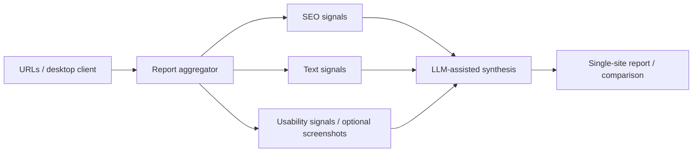

# AI Website Analyzer

**A service-oriented website-auditing application that combines extracted page signals with LLM-generated analysis and site comparisons.**

The project separates SEO checks, text analysis, usability heuristics and report
synthesis into FastAPI services. A desktop client submits URLs and displays the
aggregated result. The engineering focus is the collection-to-report workflow
and the boundaries between deterministic checks and model interpretation.

## Components

| Component | Responsibility | Source |
|---|---|---|
| SEO analyzer | HTML metadata, headings and URL signals; optional Yandex integration | [SEO_analyses](SEO_analyses) |
| Text analyzer | Text statistics, readability and model-assisted content review | [Text_analyses](Text_analyses) |
| Usability analyzer | Accessibility/responsiveness heuristics and optional screenshots | [Convenience_analyses](Convenience_analyses) |
| Aggregator | Coordinate analyzers, compare sites and synthesize recommendations | [Senior_analyser](Senior_analyser) |
| Desktop client | URL input and report display | [Desktop_app](Desktop_app) |



The model provides interpretation of collected signals. Its recommendations are
not measured search-ranking outcomes, conversion improvements or an accessibility
compliance certification.

## Run with Docker

Use Docker and Docker Compose. Configure an LLM provider credential for the
model-assisted stages; optional screenshot, proxy and Yandex integrations have
their own configuration.

```bash
git clone https://github.com/Maxi-online/ai-website-analyzer.git
cd ai-website-analyzer
cp env.example .env
```

Edit the local `.env` before starting. `OPENAI_API_KEY` is the required provider
credential. `OPENAI_MODEL`, `OPENAI_VERBOSITY` and `OPENAI_REASONING_EFFORT`
configure model requests. Proxy and third-party integration settings are optional;
see [env.example](env.example) and each service's `settings.py`.

```bash
docker compose up --build -d
docker compose ps
curl http://localhost:8004/health
curl http://localhost:8004/service_status
```

Use `docker compose logs -f` for service output and `docker compose down` to stop
the deployment. Runtime provider calls can incur provider charges; the examples
above check deployment status rather than running a site analysis.

## API entry points

| Service | Port | Endpoint |
|---|---:|---|
| SEO | 8001 | `POST /seo_analysis` |
| Text | 8002 | `POST /text_analysis` |
| Usability | 8003 | `POST /convenience_analysis` |
| Aggregator | 8004 | `POST /analyze_single_site` |
| Aggregator | 8004 | `POST /compare_sites` |
| Aggregator | 8004 | `POST /generate_recommendations` |

The comparison request uses `site1_url` and `site2_url`. A single-site request
uses `url`; consult the generated FastAPI documentation and
[request models](Senior_analyser/main.py) for the current contract.
The comparison endpoint returns a text report rather than a universal structured
scoring schema.

## Engineering choices

- Separate analyzer responsibilities and HTTP contracts instead of one monolithic prompt.
- Service-local configuration and dependency files.
- Async HTTP-based orchestration and a separate LLM client layer.
- Docker definitions for service deployment, with an optional desktop entry point.
- Optional integrations remain distinguishable from the core HTML/text workflow.

The `gpt5_agent.py` filename records the current integration's history; model
selection is configurable. No claim of a newly trained model is made.

## Validation and limitations

The repository contains the application and deployment definitions. It does not
establish a reproducible accuracy benchmark for SEO/UX judgements, production
availability or improved business outcomes. Dynamic pages, blocked fetches,
missing screenshots and partial service failures can limit the available evidence.

Useful evaluation fixtures would retain fetched HTML/screenshots, expected
deterministic findings, report references, failure responses and cost/latency.
Compare model conclusions with independent review rather than treating generated
scores as ground truth.

## Additional documentation

[Yandex integration](YANDEX_API_README.md) ·
[Docker configuration](docker-compose.yml) ·
[Aggregator model client](Senior_analyser/gpt5_agent.py)

## Author and license

Maxim Strekolovskiy. [MIT License](LICENSE). External services and dependencies
retain their respective terms.
